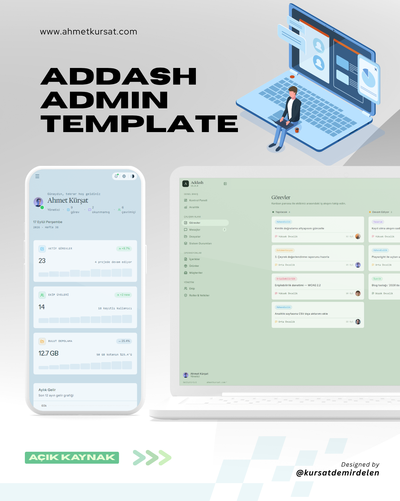
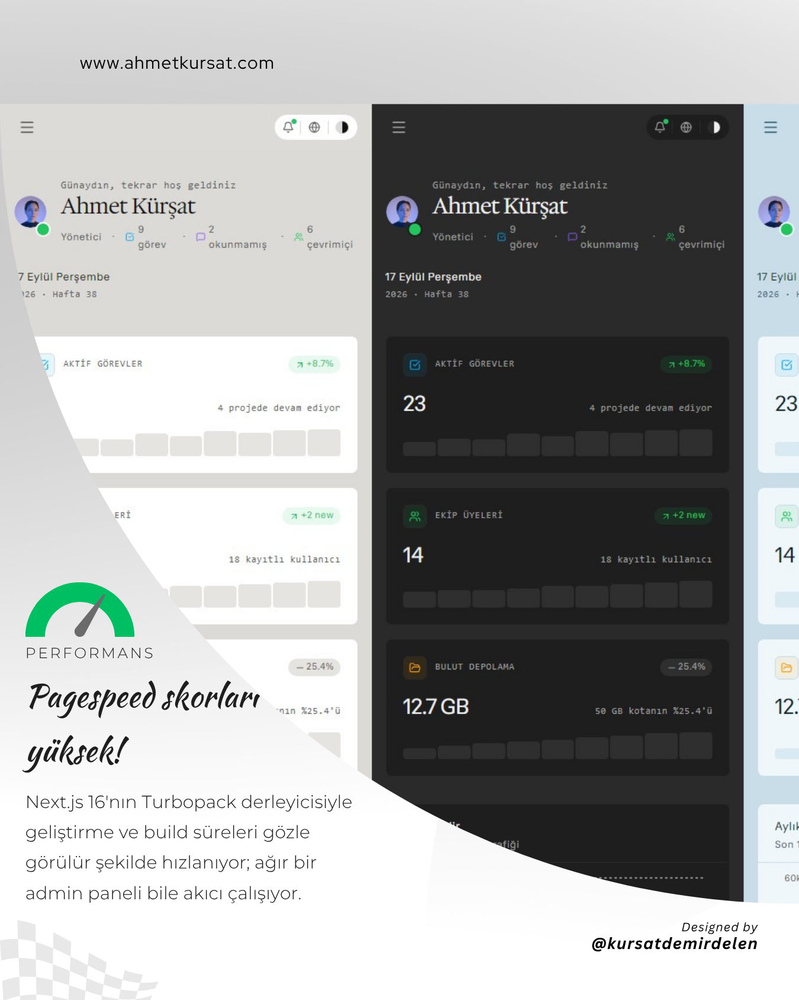
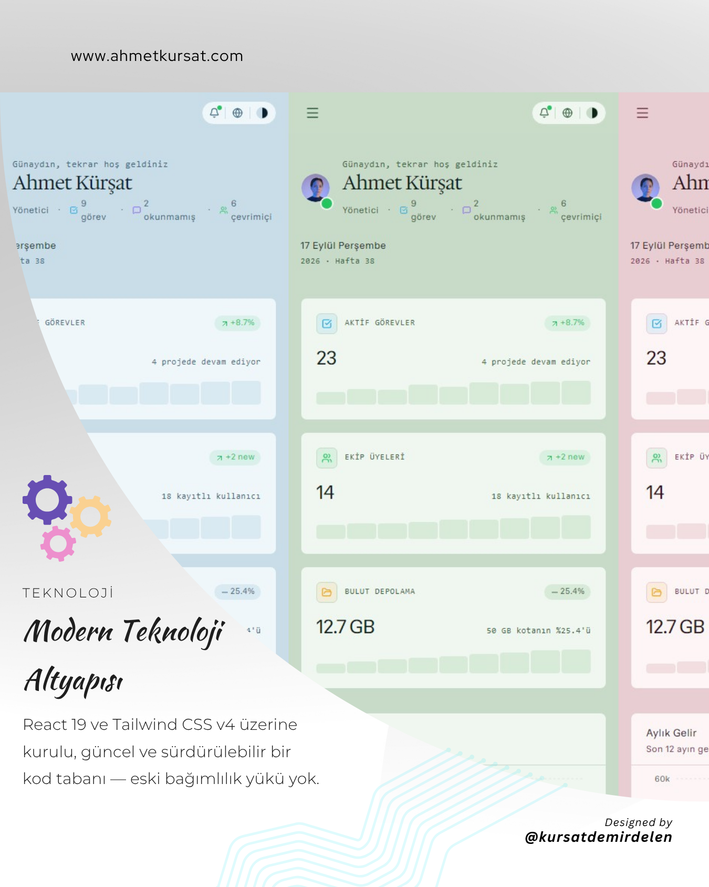
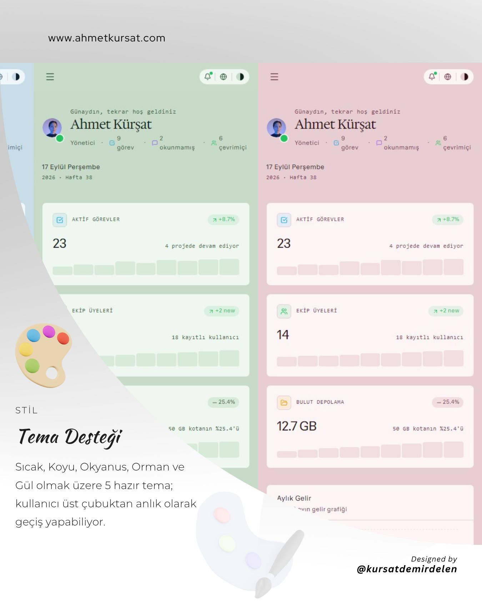
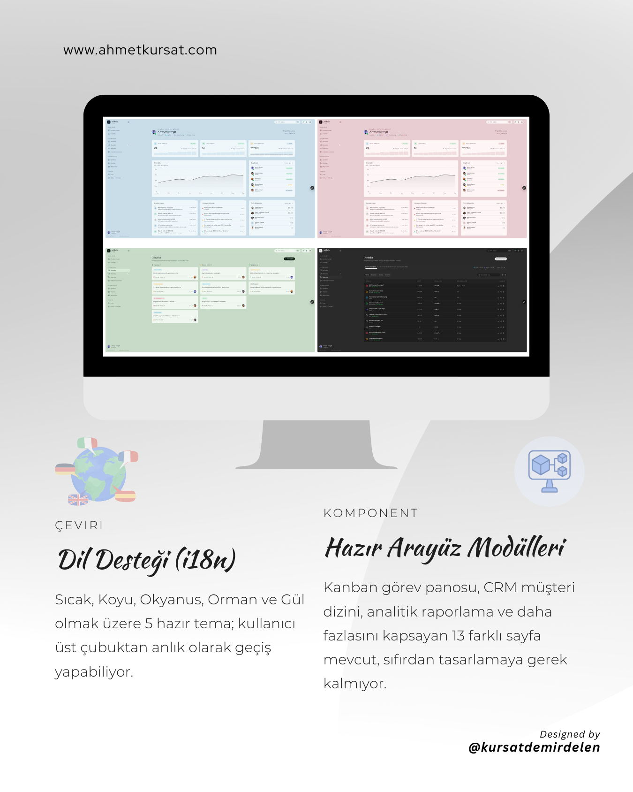
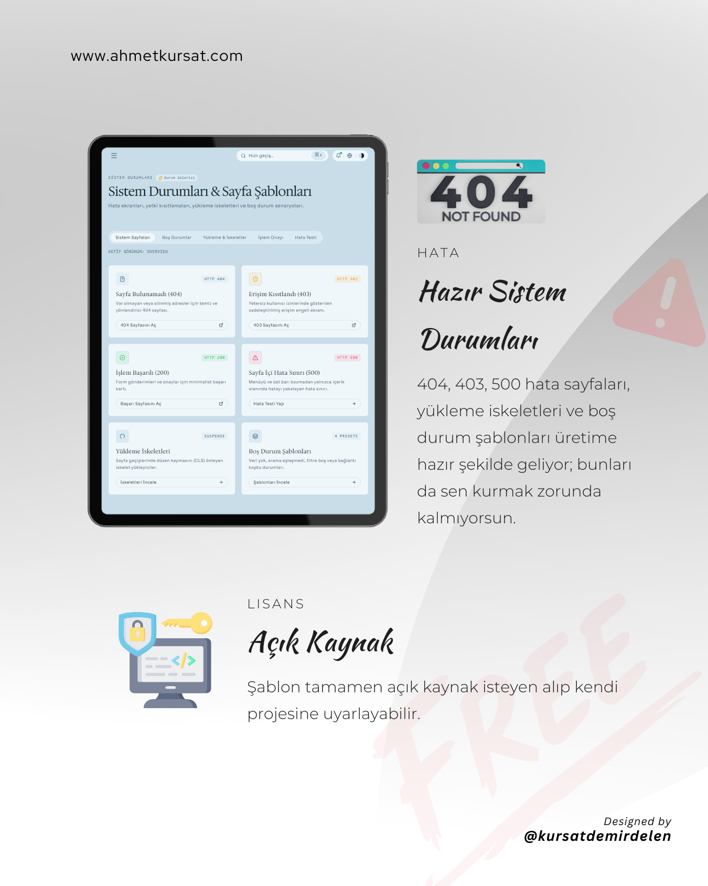

# Addash — Modern Yönetim Paneli Şablonu

<div align="left">
  <strong>🇹🇷 Türkçe (Varsayılan)</strong> · <a href="docs/README.en.md"><strong>🇬🇧 English</strong></a> · <a href="docs/ARCHITECTURE.md"><strong>🏛️ Mimari</strong></a> · <a href="docs/DESIGN.md"><strong>🎨 Tasarım</strong></a> · <a href="docs/SYSTEM-STATES.md"><strong>🚦 Sistem Durumları</strong></a>
</div>

<br />

<p align="center">
  
</p>

**Next.js 16 (Turbopack)**, **React 19** ve **Tailwind CSS v4** ile inşa edilmiş; hızlı, sade, çok amaçlı açık kaynaklı yönetim paneli başlangıç şablonu (starter template). MIT lisansı ile tamamen ücretsizdir.

**[Canlı demoyu aç →](https://addash-template.vercel.app)** · Beğendiysen repoya ⭐ vermen çok işime yarar.

> SaaS uygulamaları, şirket içi yönetim araçları, analitik platformları, içerik yönetim sistemleri (CMS), müşteri ilişkileri (CRM) veya müşteri portalları gibi her türlü yönetim arayüzü için en temiz ve en genişletilebilir başlangıç noktası olarak tasarlandı.

---

## 📸 Ekran Görüntüleri & Öne Çıkan Detaylar

<p align="center">
  
  
</p>

<p align="center">
  
  
</p>

<p align="center">
  
</p>

---

## ✨ Özellikler & 17 Gerçekçi Arayüz Modeli

Addash yalnızca tek bir gösterge paneli değil, modern yönetim panellerinde ihtiyaç duyulan tüm arayüz modellerini içerir:

1. **Kontrol Paneli (`/dashboard`)** — Operasyonel iş akışı görünümü, ekip nabzı sayaçları, mini grafikli (sparkline) özelleştirilebilir KPI kartları, aktif ekip avatarları ve son aktiviteler akışı.
2. **Analitik (`/analytics`)** — 6 metrikli yatay skorkart, çift grafik (alan gelir trendi + aylık net kâr/gider sütun grafiği) ve kâr marjı ilerleme çubuklu detaylı dönem tablosu.
3. **Görevler (`/tasks`)** — Kanban panosu modeli; kolonlar (*Yapılacak, Devam Ediyor, Tamamlandı*), öncelik etiketleri, görevli avatarları ve son teslim tarihleri.
4. **Mesajlar (`/messages`)** — Bölünmüş görünüm (split-view) gelen kutusu modeli; arama filtresi, okundu/okunmadı durumları, yıldızlı mesajlar, etiketler ve doğrudan hızlı yanıt çubuğu.
5. **Dosyalar (`/files`)** — Liste/ızgara görünüm seçeneği, kota ilerleme çubuğu, dosya tipi ikonları ve paylaşım göstergeleri içeren bulut dosya yöneticisi.
6. **İçerikler (`/posts`)** — Durum sekmeleri (*Yayında, Taslak, Zamanlandı*), kelime sayısı, okuma süresi ve yazar avatarları içeren CMS / blog tablosu.
7. **Ürünler (`/products`)** — Ürün görsel önizlemeleri, envanter doluluk çubukları ve stok durumu rozetleri içeren e-ticaret katalog modeli.
8. **Müşteriler (`/customers`)** — Hesap kademeleri (*Enterprise, Pro, Starter*), aylık gelir (MRR) takibi, durum rozetleri ve iletişim aksiyonları sunan CRM dizini.
9. **Ekip Yönetimi (`/users`)** — Arama, sıralama, durum hapları ve detay çekmeceleri içeren kullanıcı listesi tablosu.
10. **Roller & Yetkiler (`/roles`)** — Rol özet kartları ve gruplandırılmış tam RBAC (Role-Based Access Control) yetki matrisi.
11. **Bildirimler (`/notifications`)** — Zaman çizgisiyle gruplandırılmış (*Bugün, Dün, Bu Hafta*), tek tıkla okundu işaretleme ve tip rozetleri içeren bildirim merkezi.
12. **Ayarlar (`/settings`)** — Genel profil, hesap güvenlik anahtarları (passkey) ve çalışma alanını silme (danger zone) sekmeleri.
13. **Sistem Durumları & İstisnalar (`/states`)** — Editoryal hata sınırları (`error.tsx`), yetkisiz erişim ekranı (`/forbidden`), akıcı yükleme iskeletleri (`loading.tsx`), boş durum şablonları ve işlem onay makbuzu (`/success`).
14. **Takvim (`/calendar`)** — Pazartesi başlangıçlı aylık görünüm, bugün vurgusu, ay gezinmesi ve yaklaşan etkinlikler listesi.
15. **Faturalar (`/invoices`)** — Ödenen, bekleyen ve geciken toplamları, duruma göre filtre sekmeleri ve fatura tablosu.
16. **Denetim Kaydı (`/audit`)** — Güvenlik, içerik, ödeme ve erişim olaylarını kim, ne zaman, hangi IP'den yaptığıyla gösteren, aranabilir ve filtrelenebilir kayıt.
17. **Yardım Merkezi (`/help`)** — Arama kutusu, konu kartları ve açılır kapanır sık sorulan sorular.

---

## 🎨 Tasarım Sistemi & 5 Hazır Tema

İnce 1px sınır çizgileri (hairline borders), yapay gölgelerden arındırılmış düz yüzeyler ve yüksek kontrastlı tipografi ile zenginleştirilmiş gazete / editoryal broadsheet tasarım dili:

| Token | Varsayılan Renk | Anlam ve Kullanım Amacı |
|---|---|---|
| `parchment` | `#dbdad7` | Tuval arka planı ve 1px ince sınır çizgileri |
| `paper` | `#ffffff` | Yükseltilmiş kart ve form yüzeyleri |
| `sand` | `#e6e4e0` | Hover durumları, sekmeler, tablo başlıkları |
| `ink` | `#121212` | Yüksek kontrastlı ana metin ve başlıklar |
| `smoke` | `#616161` | İkincil etiketler, zaman damgaları, yumuşak sınırlar |
| `charcoal` | `#18181b` | Koyu renkli ana buton dolguları |
| `moss` | `#22c55e` | Aktif durum, başarı göstergeleri, Üye (Member) rolü |
| `amber` | `#f59e0b` | Uyarılar, bekleyen durumlar, Analist (Analyst) rolü |
| `rose` | `#f43f5e` | Hatalar, yüksek öncelik, tehlikeli bölge |
| `sky` | `#0ea5e9` | Bilgi rozetleri, bağlantılar, Editör (Editor) rolü |
| `violet` | `#8b5cf6` | Yönetici (Admin) rolü, öne çıkan etiketler, kurumsal kademe |

### 🌗 Anında Tema Değişimi
Üst menüdeki palet butonuyla tek tıkla temalar arasında geçiş yapabilirsiniz:

- **Warm** (Varsayılan) — Kremsi parşömen kağıdı ve koyu mürekkep tipografisi.
- **Dark** — Göz yormayan, ince sınırlara sahip modern antrasit/kömür teması.
- **Ocean** — Arduvaz ve deniz mavisi tonları.
- **Forest** — Mat çam yeşili ve adaçayı vurguları.
- **Rose** — Sıcak bordo kontrastına sahip editoryal pembe/gül tuvali.

> **Semantik Güvenlik**: Temalar yalnızca tuval ve yüzey renklerini değiştirir. Anlamsal durum renkleri (*Aktif = Yeşil*, *Askıda = Kırmızı* vb.) tutarlılığı korumak adına tüm temalarda sabit kalır.

---

## 🌐 Uçtan Uca Çoklu Dil Desteği (i18n)

Addash, harici kütüphane bağımlılığı olmayan, sıfır gecikmeli ve tam tip güvenliğine (type-safe) sahip bir i18n altyapısıyla gelir:
- **Varsayılan Dil**: Türkçe (`TR`) varsayılandır; İngilizce (`EN`) tam olarak desteklenir.
- **Üst Menü Düğmesi**: Üst bardaki dil değiştirici (`[ 🌐 TR ]` / `[ 🌐 EN ]`) ile anında dil değişimi.
- **Sayfa Yenileme Gerektirmez**: Zustand store ve `localStorage` üzerinde reaktif olarak çalışır; arama, filtre ve form durumlarınızı korur.
- **%100 Kapsam**: Tüm sayfalar, kırıntı menüler (breadcrumbs), tablo kolonları, durum mesajları ve form etiketleri seçilen dile dinamik olarak uyum sağlar.
- **Genişletilebilir**: Yeni bir dil eklemek için `src/locales/` altına tek bir dosya eklemek ve `Dictionary` tipini karşılamak yeterlidir.

---

## 🚀 Hızlı Komut Paleti (`⌘K` / `/`)

Klavyeden `⌘K` (veya Windows'ta `Ctrl+K` ya da üst bardaki "Hızlı geçiş…" kutusuna tıklayarak) erişebileceğiniz hızlı yönlendirme menüsü:
- **Klavye ile Gezinme**: `↑` / `↓` ok tuşları ile gezin, `Enter` ile seç, `ESC` ile kapat.
- **Türkçe ve İngilizce Arama**: Sayfalara hem Türkçe hem İngilizce anahtar kelimelerle erişebilirsiniz (*"görev"*, *"tasks"*, *"kullanıcılar"*, *"analytics"*, vb.).
- **Donanım Hızlandırmalı**: GPU'yu yoran ağır arka plan bulanıklıkları yerine saf donanım ivmeli şeffaflık ile 60+ FPS hızında açılır.

---

## 📁 Proje Klasör Yapısı

```
src/
├── app/                    # Next.js 16 App Router (22 rota)
│   ├── (auth)/login/       # Giriş sayfası
│   └── (dashboard)/        # Yönetim paneli çalışma alanı rotaları
│       ├── dashboard/      # Operasyonel genel bakış
│       ├── analytics/      # Derinlemesine grafikler ve dönem tablosu
│       ├── tasks/          # Kanban görev panosu
│       ├── messages/       # Bölünmüş gelen kutusu
│       ├── files/          # Bulut dosya yöneticisi
│       ├── posts/          # İçerik ve CMS tablosu
│       ├── products/       # Ürün ve stok kataloğu
│       ├── customers/      # CRM müşteri dizini
│       ├── users/          # Ekip üyeleri ve detay çekmecesi
│       ├── roles/          # RBAC yetki matrisi
│       ├── notifications/  # Bildirim merkezi
│       ├── settings/       # Profil, hesap ve güvenlik ayarları
│       ├── forbidden/      # 403 yetkisiz erişim görünümü
│       ├── success/        # 200 işlem başarılı görünümü
│       └── states/         # İnteraktif sistem durumları galerisi
├── components/
│   ├── ui/                 # Temel UI bileşenleri (Button, Card, Badge, Dialog...)
│   ├── layout/             # AppShell, Sidebar, Header, ThemeSwitcher, LanguageSwitcher
│   ├── data-display/       # StatCard, DataTable, Metric
│   ├── feedback/           # EmptyState, AccessDeniedCard, SuccessState
│   └── navigation/         # NavItem, Breadcrumbs, UserMenu
├── features/               # Modüler alanlar (sayfalar, tablolar, widget'lar)
├── config/
│   ├── site.ts             # Site kimliği ve varsayılan kullanıcı profili
│   ├── navigation.ts       # İki dilli menü yapısı
│   └── roles.ts            # RBAC rol ve yetki tanımları
├── hooks/
│   └── use-translation.ts  # Tip güvenli çeviri hook'u
├── locales/                # Çeviri sözlükleri (tr.ts varsayılan, en.ts, types.ts)
├── lib/
│   ├── utils.ts            # Sınıf birleştirme (cn) ve formatlayıcılar
│   └── mock-data/          # Modüler örnek veri setleri
├── store/
│   └── app-store.ts        # Zustand: menü, tema ve dil kalıcılığı (Varsayılan TR)
└── types/                  # Ortak TypeScript tipleri
```

---

## 🛠️ Hızlı Başlangıç

### Ön Koşullar
- **Node.js**: v18.18.0 veya üzeri
- **Paket Yöneticisi**: npm, pnpm veya yarn

### Kurulum

```bash
# Projeyi klonlayın
git clone https://github.com/kursatdemirdelen/addash-template.git
cd addash-template

# Bağımlılıkları yükleyin
npm install

# Geliştirme sunucusunu başlatın (Turbopack)
npm run dev
```

Tarayıcınızda [http://localhost:3000](http://localhost:3000) adresini açın.

### Canlıya Alma (Production Build)

```bash
npm run build
npm run start
```

---

## 🤝 Katkıda Bulunma & Özelleştirme

- Temaları özelleştirmek için `src/app/globals.css` dosyasını düzenleyin.
- Yeni bir dil eklemek için `src/locales/[dil].ts` oluşturup `src/locales/index.ts` dosyasına kaydedin.
- Yeni bir sayfa eklemek için `src/features/` altında yeni bir modül açıp `src/config/navigation.ts` dosyasına ekleyin.

---

## 👨‍💻 Yazar

Özenle geliştiren: **[Ahmet Kürşat](https://ahmetkursat.com)**.

---

## 📄 Lisans

Bu proje açık kaynaklıdır ve [MIT Lisansı](LICENSE) altında ücretsizdir.
